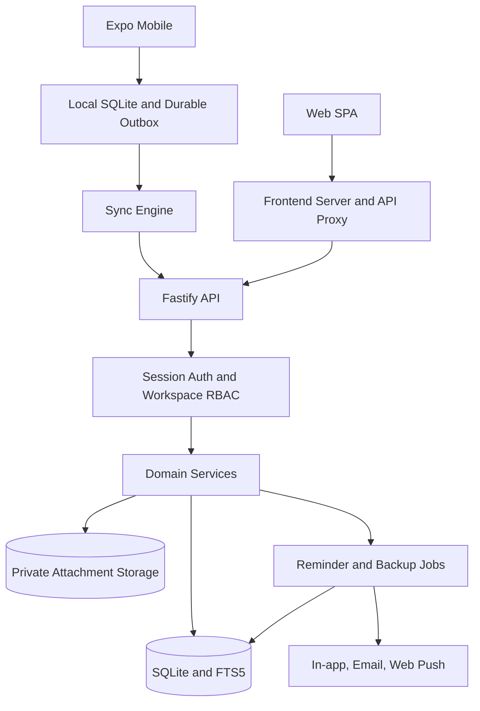

# Pocket-Dairy: System Architecture and Security

## 1. Architecture goals
- Preserve clear web/API/database/mobile boundaries.
- Keep one authoritative server for shared workspace state.
- Support offline mobile work without losing edits.
- Enforce security at backend boundaries.
- Keep attachments separate from note text.
- Make failures observable and recoverable.

## 2. Logical architecture

## 3. Trust boundaries
1. Browser/mobile clients are untrusted.
2. Frontend proxy is not an authorization boundary.
3. Fastify routes validate inputs and establish identity.
4. Services enforce membership, role, and workspace scope.
5. Database constraints/transactions protect invariants.
6. Background jobs use explicit actor and recipient context.
7. Attachment storage is private and served through authorized routes.

Never rely on hidden UI controls to protect a privileged operation.

## 4. Domain entities and invariants

| Entity | Scope | Invariant |
|---|---|---|
| User | Instance | Password hashes only |
| Session | User | Random token hashed at rest; revocable |
| Workspace | Tenant boundary | Access only via membership |
| Workspace member | Workspace/user | Role checked per request |
| Memo/note | Workspace | All reads/writes scoped |
| Memo version | Note | Bounded history |
| Folder | Workspace | Parent valid and acyclic |
| Category/tag | Workspace | Normalized uniqueness |
| Memo-tag | Workspace data | No cross-workspace links |
| Attachment | Note/workspace | Authorized metadata and bytes |
| Notification | User/workspace | Correct recipient |
| Invite | Workspace | Hashed token, expiry, consent |

The database currently calls notes `memos`; preserve existing API/schema names unless an approved migration is planned.

## 5. Note lifecycle
Create with idempotent client ID where needed. Read only in authorized workspace. Update with optimistic version check. Archive without deleting. Soft-delete to trash. Restore. Permanently delete only through explicit action. Keep history bounded. Reorder only for authorized roles.

Test lifecycle actions for owner, admin, editor, viewer, and foreign workspace cases.

## 6. Autosave and concurrency

### Web
- Debounce writes and serialize overlapping saves.
- Track last acknowledged server version.
- Do not close/discard while a save is in flight.
- On 409, distinguish metadata-only change from genuine content divergence.
- Offer explicit conflict choices; never silently overwrite.

### Mobile
- Commit local state and outbox operation atomically.
- Use stable client IDs for idempotent creates.
- Send server version on update.
- Park conflicts for user resolution.
- Protect pending/conflicted/error copies from pull overwrite.
- Requeue in-flight operations after process restart.

## 7. Authentication
- Argon2 password hashes.
- High-entropy session tokens stored as hashes.
- HTTP-only browser cookies with Secure/SameSite settings appropriate to deployment.
- Mobile credentials in SecureStore/Keychain/Keystore.
- Logout revokes server session and clears local credentials.
- Password change revokes other sessions.
- Rate limiting, account lockout, and timing-safe account recovery.
- Never log passwords, sessions, reset tokens, or invite tokens.

## 8. Authorization and workspace isolation
Roles: owner, admin, editor, viewer.
- Enforce authorization in routes/services, not UI only.
- Check membership before resource operations.
- Scope SQL by workspace and verify related resources share that scope.
- Invitations are the member-addition path.
- Owner-only operations remain owner-only.
- Preserve shared content correctly on account deletion or member removal.
- Search, export, attachments, versions, reminders, and notifications must obey the same boundary.

Cross-workspace negative tests are mandatory for every new entity.

## 9. Web security
- Treat note content, names, labels, imported files, filenames, URLs, and previews as untrusted.
- Use textContent/safe DOM APIs for user content.
- Keep Markdown sanitizer and URL allow-lists.
- Maintain CSP and security headers.
- Guard link preview SSRF including DNS rebinding.
- Reject unsafe schemes and open redirects.
- Protect cookie-authenticated mutations against CSRF.
- Restrict CORS and trust proxy headers only from known proxy addresses.

## 10. Attachment security
- Server-side size/type allow-lists and magic-byte inspection.
- Server-generated storage IDs; never trust client paths.
- Prevent traversal and symlink escapes.
- Serve only after authorization.
- Serve documents as downloads with nosniff; inline only safe images.
- Keep storage private, backed up, and integrity-checked.

## 11. Import security
- Treat ZIP/Markdown/JSON as hostile.
- Limit archive entries, uncompressed size, and path depth.
- Reject traversal and symlink entries.
- Validate field sizes and structures.
- Escape imported content at render time.
- Preview before commit.
- Never trust imported workspace IDs or file paths.
- Report skipped/failed entries clearly.

## 12. Mobile security
- Credentials only in SecureStore.
- Scope local DB/cache by normalized server and user.
- Prevent credentials forwarding across hosts/redirects.
- Clear or lock account data on logout according to documented policy.
- Do not log secrets or note bodies in diagnostics.
- Do not claim SQLite is encrypted unless encryption is implemented and verified.

## 13. Backup and recovery
- Restrict backup permissions.
- Encrypt off-host backups when destination is not trusted.
- Snapshot database and attachments consistently.
- Verify checksums and restore integrity.
- Keep retention bounded.
- Document RPO/RTO.
- Run restore drills in disposable environments.
- Never overwrite production during tests.

## 14. Threat model

| Threat | Primary mitigation |
|---|---|
| Cross-workspace access | Service scoping and negative tests |
| Session theft | TLS, HTTP-only cookie, hashed storage, revocation |
| Stored XSS | Safe Markdown, escaping, CSP |
| Malicious attachment | Signature validation, private storage |
| SSRF | Guarded fetch and DNS/IP validation |
| ZIP traversal | Safe extraction and resource limits |
| Offline data loss | Durable outbox and explicit conflicts |
| Backup theft | Permissions and optional encryption |
| Reminder leakage | Correct recipient ownership and scoped queries |
| Brute force | Rate limits and account lockout |

## 15. Operational security
- Patch dependencies and review production audit.
- Keep secrets out of Git/images/logs.
- Restrict Docker socket and host mounts.
- Run containers non-root.
- Monitor authentication failures and sync errors.
- Publish security advisories for supported releases.
- Document vulnerability reporting and response.

## 16. Release gate
Do not release with critical/high security defects, tenant isolation failures, unverified migrations, failed restore drills, silent conflict overwrites, unauthenticated attachment access, or exposed secrets.
